# Tierras

**Tu pasaporte de viajes, primero; el grupo después.** Una PWA donde cada persona guarda viajes personales o colectivos, con países, paradas y participantes, y luego compara su recorrido con el de sus grupos en un globo 3D.

Primera versión funcional: viajes multipaís, pasaporte personal, participantes que suman al pasaporte y al ranking, globo interactivo, grupos con invitaciones, búsqueda de países y ciudades, y lectura offline.

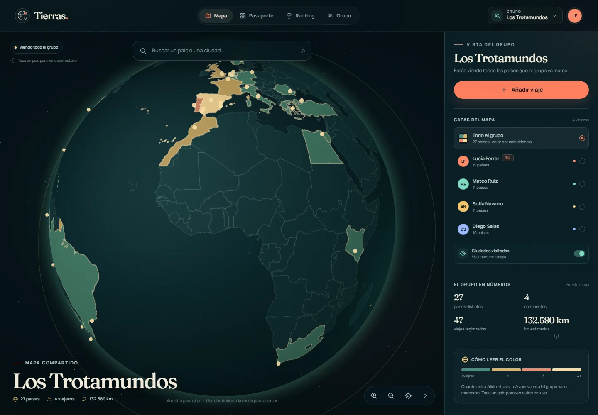

| Pasaporte personal | Ranking |
| --- | --- |
| 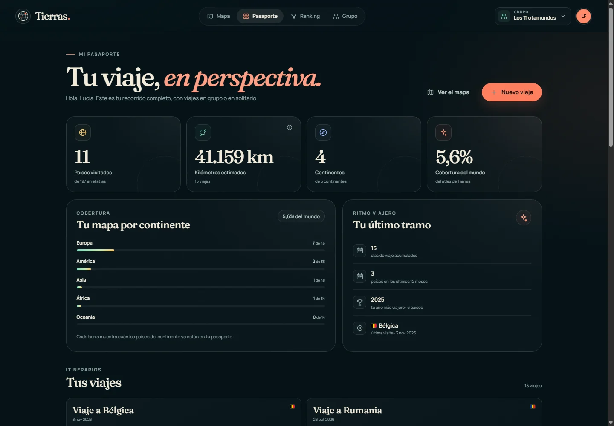 |  |

| Grupo e invitaciones | Vista móvil |
| --- | --- |
| 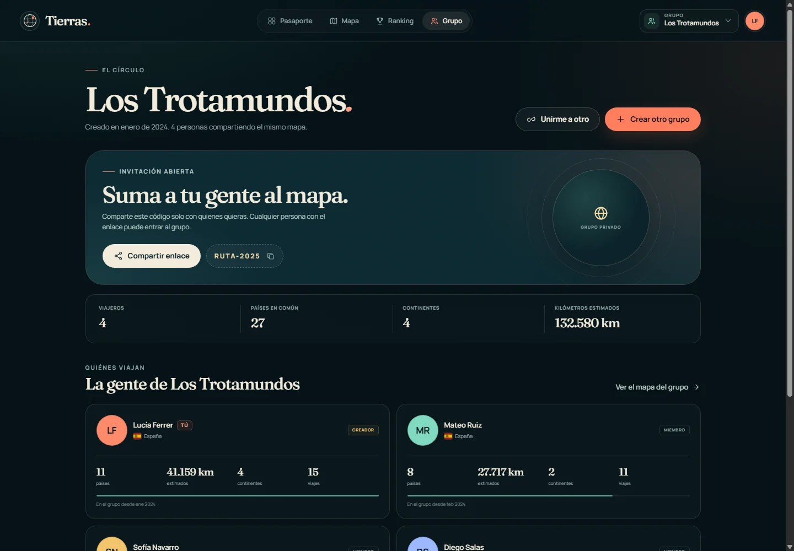 | 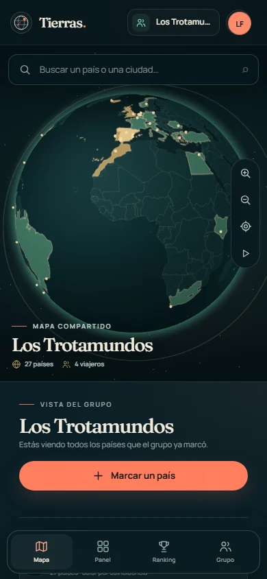 |

---

## 1. Arquitectura y stack

### Stack elegido

| Capa | Tecnología | Por qué |
| --- | --- | --- |
| Frontend | React 19 + TypeScript + Vite | Componentes modulares, tipado compartido y build rápido de una SPA/PWA. |
| Globo 3D | Three.js + `OrbitControls` | Control fino de esfera, luces, raycasting y textura; no depende de mapas, APIs ni claves externas. |
| Datos geográficos | `world-atlas` 50m + `world-countries` + `all-the-cities` | Fronteras Natural Earth simplificadas, nombres/regiones y ciudades con población, todo empaquetado. |
| Backend | Node.js 24 + Express 5 | API pequeña y suficiente; Node 24 ejecuta TypeScript nativo y trae `node:sqlite`. |
| Base de datos | SQLite (`node:sqlite`) | Persistencia real sin servicio externo, transacciones y despliegue de un solo proceso. |
| Estado remoto | TanStack Query | Cache en memoria, invalidación tras mutaciones y reutilización entre mapa, panel y ranking. |
| PWA | `vite-plugin-pwa` + Workbox | Manifest, service worker, precache y estrategia NetworkFirst para la API. |
| Estilos | CSS propio con tokens | Diseño controlado, liviano y sin dependencia de un framework CSS. |

No hay proveedor de mapas, geocodificación ni autenticación externos. Eso mantiene la primera versión desplegable en un único servidor y permite que mapa y buscador funcionen sin red.

### Estructura

```
.
├── server/
│   ├── app.ts                 # Express, seguridad, API y estáticos
│   ├── db.ts                  # SQLite y migraciones versionadas
│   ├── auth.ts                # scrypt, sesiones y cookies
│   ├── group-service.ts       # grupos, comparación y métricas
│   ├── trip-service.ts        # viajes, paradas, participantes y pasaporte
│   ├── seed.ts                # datos demo idempotentes
│   ├── invite.ts              # códigos de invitación
│   └── routes/                # auth, grupos, viajes y /me
├── shared/
│   ├── data/countries.ts      # 197 destinos generados
│   ├── countries.ts           # helpers de país
│   ├── geo.ts                 # Haversine y métricas
│   ├── leaderboard.ts         # criterios y desempates
│   └── types.ts               # contratos API
├── src/
│   ├── components/            # mapa, viajes, grupo, layout y UI
│   ├── contexts/              # auth, grupo y toasts
│   ├── lib/
│   │   ├── globeEngine.ts     # escena Three.js
│   │   ├── globeTexture.ts    # textura política generada en canvas
│   │   ├── atlas.ts           # GeoJSON + point-in-polygon
│   │   └── places.ts          # índice de búsqueda local
│   ├── pages/                 # mapa, panel, ranking, grupo, auth
│   └── data/                  # GeoJSON de fronteras y ciudades
├── scripts/                   # generación de datos/iconos y QA visual
├── tests/                     # pruebas de API y métricas
└── public/                    # manifest, iconos y banderas offline
```

### Flujo

1. El cliente consulta `/api/me/overview` para el pasaporte personal y `/api/groups/:id` para el mapa comparado del grupo.
2. El globo genera una textura equirectangular en un `<canvas>`: océano, tierra, fronteras y países visitados.
3. Al hacer *raycast* sobre la esfera se convierte el punto a latitud/longitud y `d3-geo` resuelve el país.
4. Las mutaciones de viajes invalidan el pasaporte, los viajes y el grupo activo. El servidor recalcula métricas desde países distintos y devuelve la copia autoritativa.
5. El service worker precachea shell, fuentes, banderas y bundle; las respuestas GET de la API quedan en un cache NetworkFirst para lectura offline.

---

## 2. Modelo de datos

```sql
users (
  id TEXT PRIMARY KEY,
  name TEXT NOT NULL,
  email TEXT NOT NULL UNIQUE COLLATE NOCASE,
  password_hash TEXT NOT NULL,           -- scrypt: salt:hash
  home_country_code TEXT NOT NULL,       -- ISO 3166-1 alpha-2
  created_at TEXT NOT NULL
)

groups (
  id TEXT PRIMARY KEY,
  name TEXT NOT NULL,
  owner_id TEXT NOT NULL REFERENCES users(id),
  invite_code TEXT NOT NULL UNIQUE,      -- 8 caracteres, sin ambigüedad
  created_at TEXT NOT NULL
)

memberships (
  group_id TEXT REFERENCES groups(id),
  user_id TEXT REFERENCES users(id),
  role TEXT CHECK (role IN ('owner', 'member')),
  joined_at TEXT NOT NULL,
  PRIMARY KEY (group_id, user_id)
)

trips (
  id TEXT PRIMARY KEY,
  owner_id TEXT NOT NULL REFERENCES users(id),
  title TEXT NOT NULL,
  start_date TEXT NOT NULL,              -- AAAA-MM-DD
  end_date TEXT NOT NULL,
  created_at TEXT NOT NULL
)

trip_countries (
  id TEXT PRIMARY KEY,
  trip_id TEXT REFERENCES trips(id) ON DELETE CASCADE,
  country_code TEXT NOT NULL,            -- ISO 3166-1 alpha-2
  UNIQUE (trip_id, country_code)
)

trip_stops (
  id TEXT PRIMARY KEY,
  trip_id TEXT REFERENCES trips(id) ON DELETE CASCADE,
  country_code TEXT NOT NULL,
  city_name TEXT,
  lat REAL,
  lng REAL,
  position INTEGER NOT NULL,             -- orden del itinerario
  start_date TEXT,
  end_date TEXT,
  note TEXT,
  created_at TEXT NOT NULL
)

trip_participants (
  trip_id TEXT REFERENCES trips(id) ON DELETE CASCADE,
  user_id TEXT REFERENCES users(id),
  role TEXT CHECK (role IN ('owner', 'member')),
  joined_at TEXT NOT NULL,
  PRIMARY KEY (trip_id, user_id)
)

sessions (
  id TEXT PRIMARY KEY,                   -- SHA-256 del token de cookie
  user_id TEXT REFERENCES users(id),
  expires_at TEXT NOT NULL,
  created_at TEXT NOT NULL
)
```

Decisiones del modelo:

- **El viaje es la unidad principal**, no el país. Un viaje puede abarcar varios países y tener paradas ordenadas.
- **El pasaporte es personal**: suma todos los viajes en los que participas, pertenezcan o no a un grupo.
- **Un grupo es una lente comparativa**: muestra las estadísticas de sus miembros calculadas desde sus pasaportes personales. Incluye viajes en solitario y viajes colectivos.
- **Los participantes cuentan**: si te añaden a un viaje, sus países suman a tu pasaporte y al ranking de tus grupos. Solo el propietario puede editar el viaje.
- **Varios viajes al mismo país**: un país cuenta una vez para países y kilómetros, pero el historial conserva todos los viajes.
- **Las paradas son detalle descriptivo**: una ciudad sin coordenadas sigue en el itinerario, pero no se inventa un punto en el globo.
- **Fechas**: el viaje tiene rango de fechas; las paradas pueden tener fechas opcionales dentro de ese rango.
- **Migración versionada**: `visits` y `visit_cities` quedan como fuente histórica. La versión 2 crea viajes personales, colapsa marcas duplicadas de la misma persona/país/fecha y conserva las paradas. La versión se guarda con `PRAGMA user_version`.
- **El código de invitación es permanente en esta versión** y lo ven todos los miembros del grupo. No hay enlace con caducidad.
- **Rol**: `owner` identifica al creador; el propietario del viaje puede editarlo.
- **Sesión**: cookie `HttpOnly`, `SameSite=Lax`, 30 días; el token se guarda hasheado en SQLite.

### Cálculo de kilómetros

Se usa **distancia ortodrómica (great-circle)**, no rutas reales:

1. El punto de partida es la primera parada registrada en el país base; si no existe, el centroide del país elegido al registrarse.
2. Se excluye el país base del cálculo de piernas (marcar tu propio país no suma kilómetros).
3. Para cada país se toma su **primer viaje** por fecha de inicio. Varios viajes al mismo país no duplican el punto.
4. Los países restantes se ordenan por esa fecha y, para fechas iguales, por `created_at`.
5. Se suman las distancias Haversine entre puntos consecutivos.
6. No se suma el regreso al origen.
7. El resultado se redondea al km entero.

```txt
km = Σ haversine(punto[i-1], punto[i])
```

- Punto de un país = primera parada con coordenadas de su primer viaje o centroide del país.
- Kilómetros del grupo = **suma de los kilómetros estimados de sus miembros**.
- Ejemplo: base Madrid → Lisboa → París suma dos piernas; no cuenta Madrid → centroide de España ni París → Madrid.

Limitación explícita: no son kilómetros de vuelo ni de ruta por carretera, y no reflejan viajes intermedios no registrados. La UI lo aclara con "estimados" y un tooltip de criterio.

---

## 3. Implementación por módulo

### 3.1 Mapa 3D

- Selector **Mi pasaporte / Grupo** en la esquina superior izquierda.
- **Mi pasaporte** es la vista por defecto: muestra todos los países de tus viajes, sin necesidad de grupo.
- **Grupo** compara los países de los miembros y se abre con `?vista=grupo` desde el grupo.
- Si no hay grupo, el selector ofrece crearlo; el mapa personal sigue funcionando.
- Esfera de Three.js con cámara `PerspectiveCamera` y `OrbitControls` (arrastre, rueda/pellizco, auto-rotación pausable).
- La textura se genera a 3072×1536 px (2048 en pantallas pequeñas) con:
  - océano y retícula;
  - **todas las geometrías** de `world-atlas`, incluidas dependencias no seleccionables, para que no haya huecos de océano sobre tierra;
  - relleno de países visitados: en vista **Grupo** el color indica cuántos miembros lo marcaron (1 → 4+); en vista de un **miembro** se usa su color de identidad;
  - contorno dorado del país seleccionado;
  - puntos para países diminutos o sin polígono propio.
- Click/toque: raycasting → coordenadas esféricas → `d3-geo` `geoContains` → ISO del país.
- Búsqueda: anima la cámara al punto, deja un marcador pulsante y resalta el país.
- Atmósfera con shader, estrellas, anillo orbital decorativo y luces suaves.
- Si WebGL falla, se muestra un estado de error explicativo. No se incluye una segunda proyección porque la vista 3D es la implementación principal de esta versión.

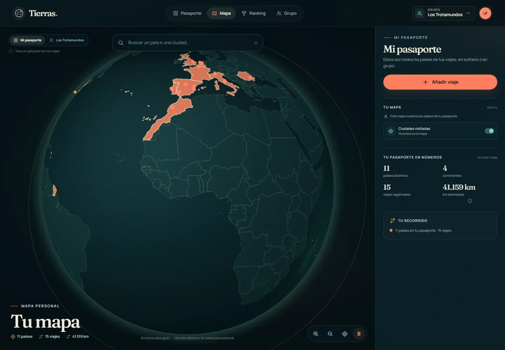

### 3.2 Grupos e invitaciones

- Crear grupo: nombre, código irreversible, membresía `owner` en una transacción.
- Invitar: código de 8 caracteres + enlace `/unirse/:code`; copiar y compartir nativo.
- Unirse por código o enlace; el endpoint normaliza guiones/minúsculas y detecta duplicados.
- Selector de grupo en el header, persistido en `localStorage`.
- Cada grupo compara los pasaportes de sus miembros. Un usuario ajeno recibe 404, nunca datos del grupo.

### 3.3 Viajes y paradas

- El viaje es la unidad que se crea y se edita; puede tener **varios países**.
- Cada viaje guarda título, fecha de inicio y fin, paradas ordenadas, participantes y notas por parada.
- Las paradas se eligen con el buscador local de países y ciudades. Una parada sin coordenadas sigue en el itinerario, pero no se inventa en el globo.
- Las fechas por parada son opcionales y deben quedar dentro del rango del viaje.
- Los participantes se eligen entre personas que comparten algún grupo con el propietario.
- **Los países del viaje cuentan para el pasaporte y el ranking de cada participante.**
- Se permiten varios viajes al mismo país. El historial se conserva y los países distintos no se duplican.
- La ficha del país muestra cada viaje y sus ciudades; el propietario puede añadir o quitar paradas desde ahí o editar el viaje completo desde el pasaporte.
- El panel personal permite editar y eliminar viajes. Al eliminar un viaje se recalculan países, kilómetros y ranking.

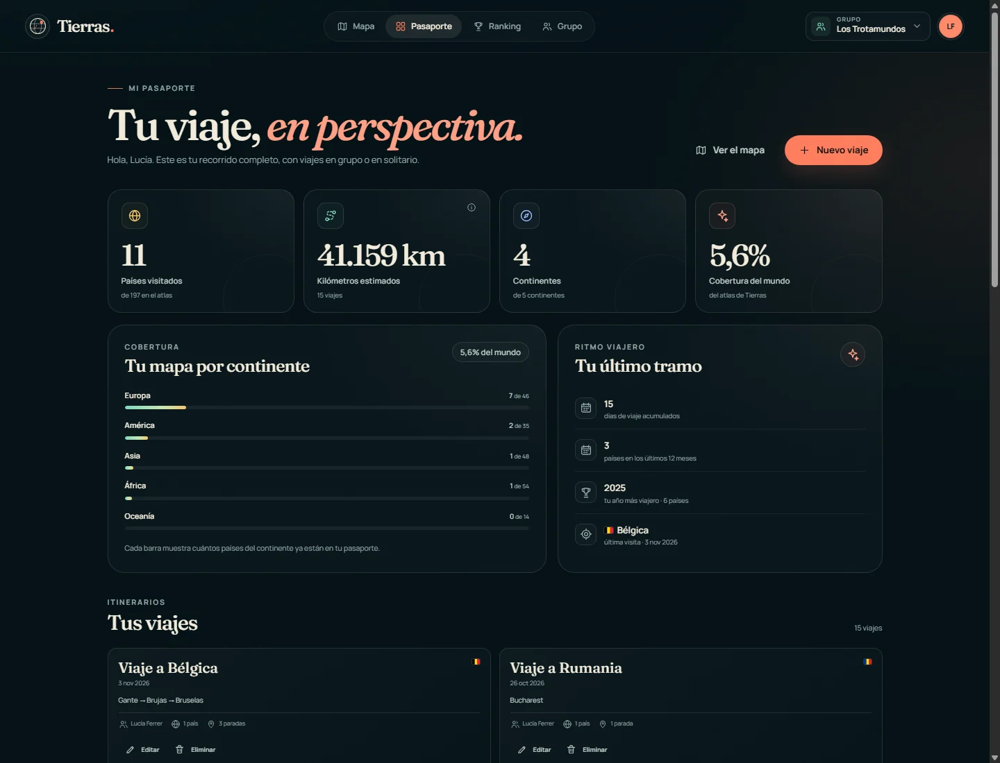

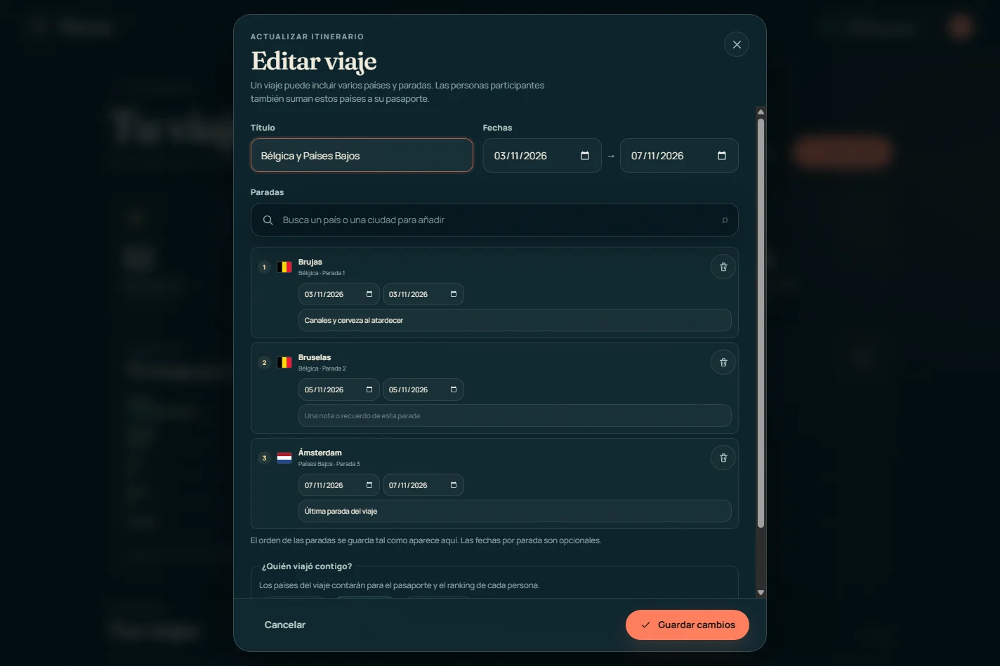

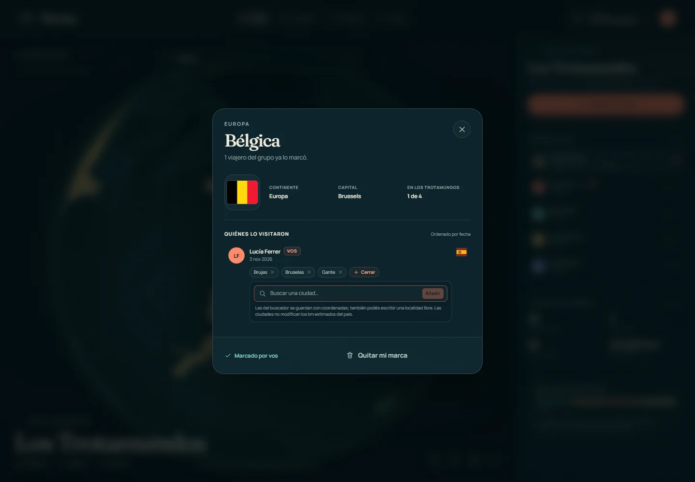

#### Puntos en el globo y baliza

- Cada ciudad con coordenadas se dibuja como un **punto pequeño** sobre el globo.
- En vista **Todo el grupo** los puntos son dorados y se agrupan por coordenadas: Bruselas visitada por tres personas es un solo punto.
- En vista de un **miembro** se muestran solo sus ciudades y toman su color de identidad.
- Al hacer click en un punto, la cámara enfoca la ciudad y aparece una **baliza**: bandera, anillo pulsante, nombre de la ciudad y cantidad de viajeros.
- La etiqueta de la baliza abre la ficha del país; la “×” o un click en el océano la cierran.
- Mientras hay una baliza activa se pausa la rotación automática.
- La capa se puede apagar con el interruptor **“Ciudades visitadas”** en la barra lateral.
- Si la ciudad no tiene coordenadas, no se inventa una ubicación: se muestra en la ficha y en el pasaporte, pero no en el mapa.
- Buscar una ciudad ya visitada abre directamente su baliza.
- Los puntos y la baliza son solo visuales: **no alteran kilómetros, países ni ranking**.

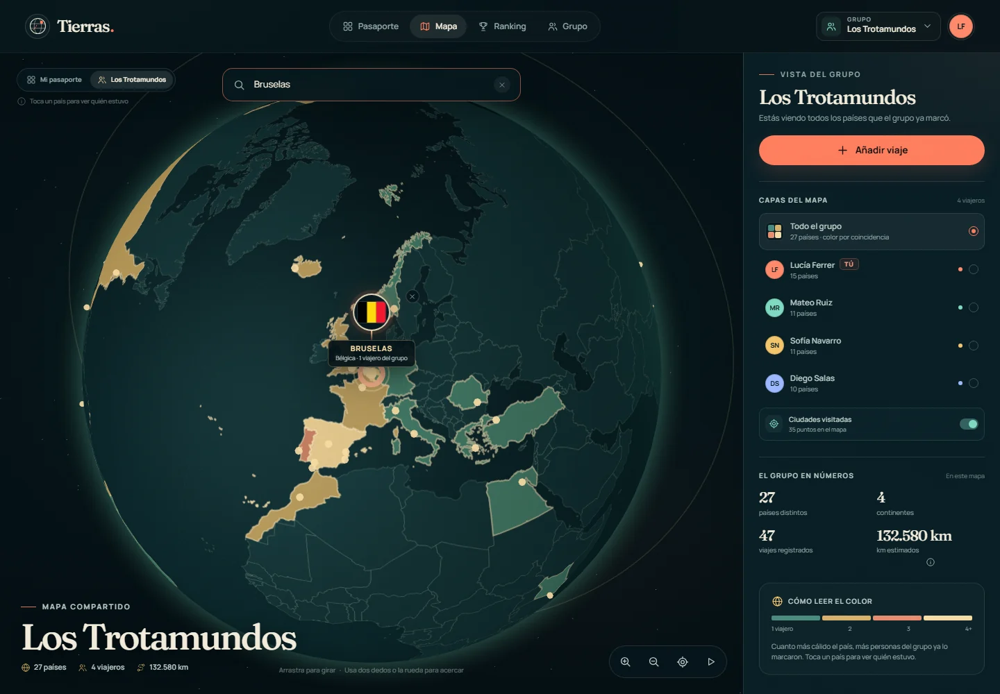

En móvil la ficha del país sigue siendo una hoja inferior y la baliza conserva la etiqueta legible:

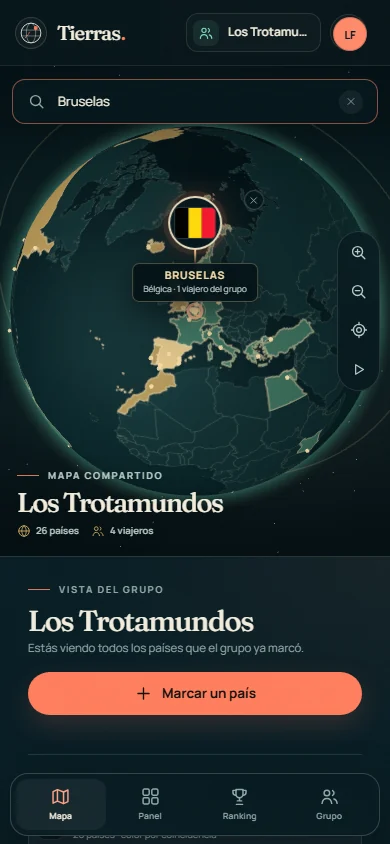

### 3.4 Pasaporte personal (entrada principal)

- Después de iniciar sesión, la app entra en `/pasaporte`.
- La raíz `/` también redirige al pasaporte; `/panel` se mantiene como redirección por compatibilidad.
- La navegación ordena **Pasaporte → Mapa → Ranking → Grupo**.
- El pasaporte funciona **sin grupo**. Si no hay grupos, muestra un CTA para crear uno o unirse; el mapa, el ranking y la vista de grupo explican que la comparación es opcional y enlazan de vuelta al pasaporte.

Métricas derivadas de **todos los viajes en los que participa el usuario**, pertenezcan o no a un grupo:

- países distintos;
- kilómetros estimados;
- continentes distintos;
- porcentaje del atlas;
- cobertura por continente;
- días de viaje acumulados y viajes registrados;
- actividad de los últimos 12 meses, año con más países y última visita;
- listado de viajes con países, paradas, fechas y participantes;
- pasaporte con todos los países y ciudades, con enlace al mapa del grupo activo.

### 3.5 Ranking

Tres categorías, con criterio visible en la propia pantalla. Cada miembro se calcula desde su pasaporte personal, así que también cuentan los viajes en solitario:

1. **Países visitados**: países distintos por miembro.
2. **Kilómetros estimados**: suma Haversine de países distintos, usando el primer viaje de cada país.
3. **Continentes**: continentes distintos con al menos un país.

Desempate: más países → más kilómetros → nombre alfabético. Podio para los tres primeros y tabla completa con tu fila resaltada.

### 3.6 Búsqueda

- Índice local de **197 destinos** y **4.466 ciudades** (capitales + ciudades de 100.000+ habitantes).
- Coincidencia sin acentos y alias en español para países y ciudades frecuentes (`Londres`, `Roma`, `CDMX`, `Holanda`, etc.).
- Teclado: flechas, Enter y Escape; resultados con bandera, país y tipo.
- Seleccionar un país o una ciudad no visitada enfoca el globo y abre la ficha del país; si la ciudad ya está registrada en la capa activa, abre su baliza.
- Funciona sin conexión porque el índice viaja en el bundle.

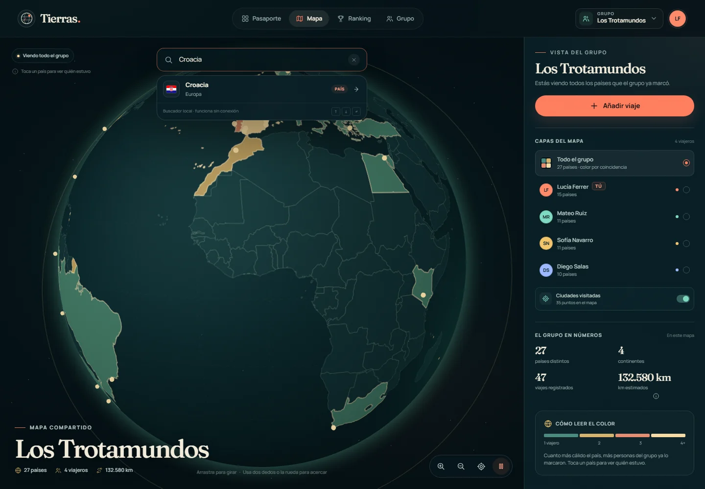

### 3.7 PWA

- Manifest completo con nombre, colores, iconos 192/512/maskable, atajos e `id`.
- `start_url` en `/pasaporte`; el atajo principal abre el pasaporte y los secundarios el mapa y el ranking.
- Service worker generado por Workbox:
  - precache del shell, CSS/JS, fuentes, banderas y datos;
  - `NetworkFirst` para GET `/api/*` con timeout de 3 s y cache de hasta 30 días;
  - navegación SPA con fallback offline;
  - limpieza de versiones viejas y actualización automática.
- Instalación verificada con errores de manifiesto e instalabilidad vacíos.

**Funciona sin conexión**

- abrir la app instalada y navegar por el shell;
- globo 3D, capas y datos de la última sincronización;
- puntos de ciudades y balizas usando las coordenadas cacheadas;
- panel, ranking y grupo con la copia cacheada;
- búsqueda local de países y ciudades;
- banderas, fuentes e iconos.

**Requiere conexión**

- iniciar sesión o registrarse;
- crear/unirse a un grupo;
- crear, editar o eliminar viajes y participantes;
- añadir o quitar paradas;
- compartir una invitación nueva (copiar el enlace funciona offline, pero unirse no);
- cualquier escritura o sincronización. No hay cola offline ni resolución de conflictos en v1.

Al cerrar sesión, expirar la sesión o iniciar sesión con otra cuenta se vacía el cache de API (`tierras-api-*`) para no mezclar datos privados. La UI muestra un aviso "Sin conexión · datos guardados".

El paquete offline pesa ~4,6 MB porque incluye Three.js, el atlas geográfico y 197 banderas SVG; el JS comprimido son ~832 KB.

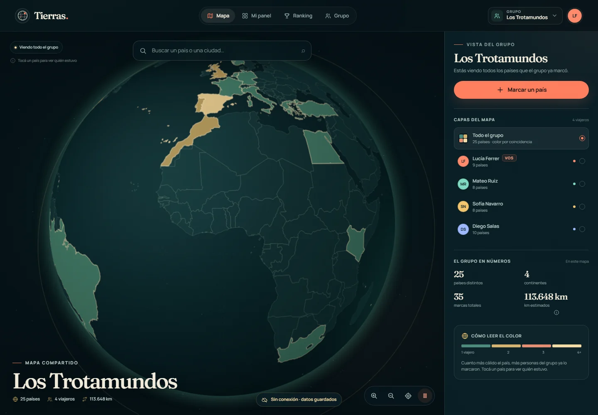

### 3.8 Idioma y copy

- Interfaz en **español de España**, con tuteo: “Toca un país”, “Inicia sesión”, “Prueba de nuevo”.
- Sin voseo rioplatense ni fórmulas de usted; se prefieren términos habituales en España (“móvil”, “añadir”, “introduce tu email”).
- Fechas y números con locale `es-ES`.
- Los mensajes del servidor mantienen **códigos estables** (`ALREADY_MEMBER`, `VALIDATION_ERROR`, etc.) para poder traducirlos en el futuro.
- No hay i18n en v1. Si se añade otro idioma, el camino previsto es `es-ES` como base y una variante regional como `es-AR`, no mezclar registros en la misma interfaz.
- Una prueba automática revisa que no reaparezcan formas de voseo en `src`, `server`, `shared`, `README.md`, `index.html` o `vite.config.ts`.

---

## 4. API

Todas las rutas privadas usan cookie de sesión y comprueban membresía.

| Método | Ruta | Descripción |
| --- | --- | --- |
| GET | `/api/config` | Config pública; en demo devuelve la cuenta de prueba. |
| POST | `/api/auth/register` | Crea usuario y sesión. |
| POST | `/api/auth/login` | Inicia sesión. |
| POST | `/api/auth/logout` | Borra sesión y cookie. |
| GET | `/api/auth/me` | Usuario actual. |
| GET | `/api/groups` | Grupos del usuario con rol y conteos. |
| POST | `/api/groups` | Crea grupo; devuelve código de invitación. |
| POST | `/api/groups/join` | Une por código. |
| GET | `/api/me/overview` | Pasaporte personal: stats, viajes y países agregados. |
| GET | `/api/trips` | Viajes en los que participa el usuario. |
| POST | `/api/trips` | Crea un viaje multipaís con paradas y participantes. |
| PATCH | `/api/trips/:id` | Edita un viaje propio. |
| DELETE | `/api/trips/:id` | Elimina un viaje propio. |
| GET | `/api/groups/:id` | Overview comparativo: miembros, viajes/países y stats. |
| POST | `/api/groups/:id/visits` | Atajo compatible: crea un viaje de un solo país. |
| POST | `/api/groups/:id/visits/:visitId/cities` | Añade una parada al viaje propio. |
| DELETE | `/api/groups/:id/visits/:visitId/cities/:cityId` | Quita una parada del viaje propio. |
| DELETE | `/api/groups/:id/visits/:visitId` | Quita un país del viaje propio. |

Errores con `{ error, code, fieldErrors? }`. El servidor valida país, fechas, coords, pertenencia, participantes que compartan grupo y origen de mutaciones (`Origin` vs `Host`).

---

## 5. Puesta en marcha

### Requisitos

- Node.js **24+** (por `node:sqlite`, carga de `.env` y ejecución nativa de TypeScript).
- npm 11+.

### Desarrollo local

```bash
npm install
npm run dev
```

Abre `http://localhost:5173`. Vite hace proxy de `/api` a `http://127.0.0.1:3001` y el servidor arranca en modo demo.

Cuenta demo:

```txt
lucia@tierras.app
viajar2026
```

El grupo demo principal es **Los Trotamundos** (4 personas, 25 países compartidos). También existe **Casa Nómada**.

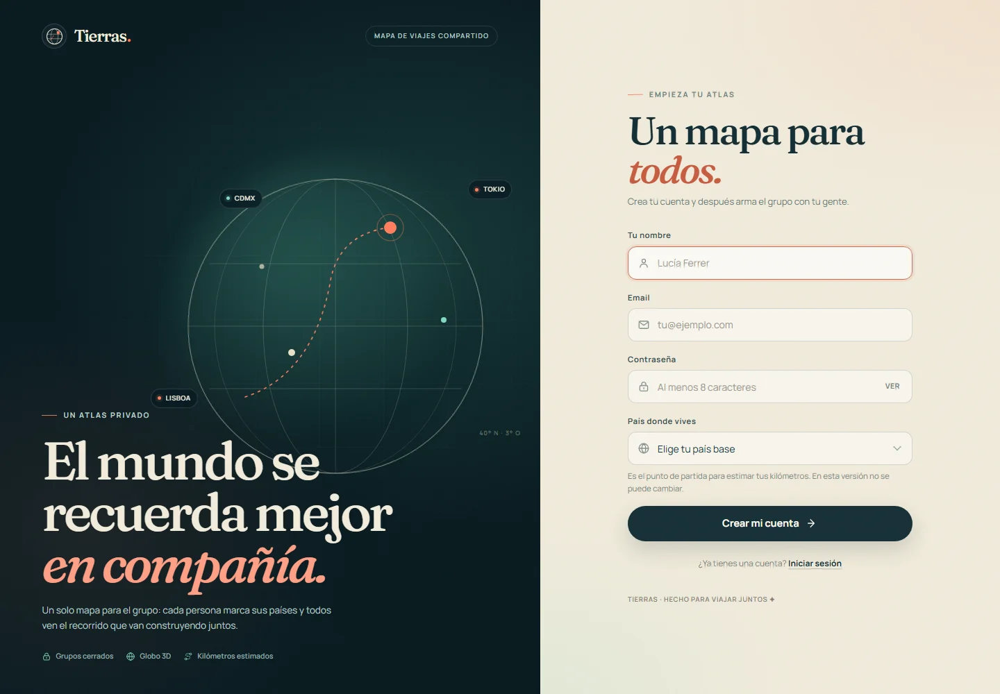

### Build y ejecución

```bash
npm run build
npm start
```

- `npm run build` valida tipos, genera el cliente PWA y los estáticos en `dist/`.
- `npm start` sirve la API y `dist/` en `http://localhost:3001`.
- Al arrancar se crea el esquema base y se ejecutan las migraciones pendientes. La conversión de `visits.city_name` a `visit_cities` y de las visitas antiguas a viajes está versionada y se aplica una única vez. Haz un backup de la base antes del primer arranque con esta versión.
- El servidor lee `.env` si existe (copia `.env.example`).
- `SEED_DEMO=false` por defecto: una base nueva arranca vacía. Para ver la demo con el build: `npm run start:demo`.
- Si la base ya fue sembrada en desarrollo, los usuarios demo siguen existiendo. **Para un despliegue real, usa una base nueva y `SEED_DEMO=false`.**

### Variables

| Variable | Por defecto | Uso |
| --- | --- | --- |
| `PORT` | `3001` | Puerto HTTP. |
| `HOST` | `0.0.0.0` | Interfaz de escucha. |
| `DB_PATH` | `data/tierras.db` | Archivo SQLite; el directorio se crea solo. |
| `SEED_DEMO` | `false` | Siembra la demo **solo si la base está vacía**. |
| `COOKIE_SECURE` | `false` | Poner `true` con HTTPS. |
| `API_URL` | `http://127.0.0.1:3001` | Solo dev: destino del proxy de Vite. |

### Despliegue con Docker

```bash
docker compose up -d --build
```

Incluye volumen persistente para `/app/data`. El contenedor no publica HTTPS: coloca Nginx, Caddy o Traefik delante y activa `COOKIE_SECURE=true`. El proxy debe preservar el header `Host` porque las mutaciones validan `Origin`.

Ejemplo Nginx:

```nginx
server {
  listen 443 ssl http2;
  server_name tierras.example.com;

  location / {
    proxy_pass http://127.0.0.1:3001;
    proxy_set_header Host $host;
    proxy_set_header X-Forwarded-Proto $scheme;
  }
}
```

Checklist de producción:

1. HTTPS y `COOKIE_SECURE=true`.
2. Volumen persistente para `data/`.
3. `SEED_DEMO=false` y base vacía.
4. Backup de SQLite (`.backup`) y del WAL.
5. Una sola instancia/replica: SQLite en modo WAL no está pensado para varias instancias escribiendo.
6. El service worker exige HTTPS (excepto `localhost`).
7. Tamaño máximo de subida JSON fijado en 100 KB; no hay archivos.

---

## 6. Pruebas

### Automáticas

```bash
npm test
npm run typecheck
npm run build
```

`npm test` ejecuta **17 pruebas** con el runner nativo en modo sin aislamiento (compatible con entornos que bloquean procesos hijos) y cubre:

- Haversine con tolerancia;
- conteo de países/continentes y porcentaje;
- orden cronológico y punto base sin pierna local;
- desempate del ranking;
- flujo API completo: registro, dos usuarios, grupo, invitación con guion, viajes, métricas y borrado;
- ciudades: alta, listado ordenado, duplicado sin distinguir mayúsculas (409), borrado, cascada al quitar el país y autorización del dueño;
- migración versionada de `visits.city_name` a `visit_cities` y de visitas antiguas a viajes;
- viajes multipaís: países únicos, paradas ordenadas, participantes que suman al pasaporte;
- pasaporte personal sin grupo, con viaje propio;
- varios viajes al mismo país sin duplicar países ni kilómetros;
- los kilómetros no cambian al agregar ciudades;
- construcción de marcadores de ciudad: agrupación por coordenadas, filtrado por miembro y omisión de ciudades sin ubicación;
- guardia de copy: falla si reaparece una forma de voseo rioplatense en la interfaz o la documentación;
- validación de formularios y aislamiento de grupos ajenos (404).

Verificación PWA realizada en build de producción:

- `Page.getAppManifest` → sin errores;
- `Page.getInstallabilityErrors` → `[]`;
- service worker activo y controlando la página;
- recarga con red emulada offline → globo, datos del grupo y aviso de sin conexión funcionando.

### Checklist manual mínima

1. Abrir `/registro`, crear cuenta con país base y entrar.
2. Crear un viaje personal con dos países y paradas; comprobar el pasaporte.
3. Crear un grupo; copiar el código.
4. En ventana privada, crear otra cuenta, abrir `/unirse/<código>` y unirse.
5. Crear un viaje colectivo con paradas y participantes; comprobar que los países aparecen en el pasaporte de cada participante.
6. Verificar que el mapa y el ranking del grupo comparan los pasaportes personales, incluidos los viajes en solitario.
7. Crear un segundo viaje al mismo país; comprobar que el país no se duplica y que el historial muestra dos viajes.
8. Editar un viaje y eliminar una parada; comprobar que los km no cambian al quitar una ciudad.
9. Cerrar la ficha, hacer click en el punto de Bruselas y comprobar la baliza, la bandera, la etiqueta y el acceso a la ficha.
10. Buscar “Bruselas” y comprobar que abre directamente la baliza; apagar y encender “Ciudades visitadas”.
11. Intentar añadir una ciudad duplicada → mensaje de error.
12. Eliminar un viaje desde el pasaporte; confirmar que métricas y ranking se recalculan.
13. Instalar la PWA desde el menú del navegador; recargar sin red y comprobar la lectura offline.
14. Intentar crear o editar un viaje sin red → la UI lo impide con aviso.

---

## 7. Supuestos abiertos

Estos puntos no estaban especificados y se resolvieron así para esta v1. Son los primeros a validar:

1. **Autenticación mínima**: email + contraseña, sin verificación de email, recuperación, rate limiting ni segundo factor. Sesiones de 30 días.
2. **Lista canónica de 197 destinos**: Estados miembros de la ONU, observadores permanentes (Vaticano y Palestina), Kosovo y Taiwán. Quedan fuera dependencias y territorios de ultramar como Groenlandia o Puerto Rico, aunque se dibujan en el globo.
3. **Varios viajes por país**: un país se cuenta una sola vez para países y kilómetros, pero se conservan todos los viajes y sus fechas.
4. **Ciudades opcionales y abiertas**: no hay catálogo administrativo de todas las ciudades ni geocodificación inversa. El buscador cubre capitales y ciudades de 100.000+ habitantes; las localidades fuera del dataset se pueden escribir libremente, sin coordenadas. Las ciudades sin coordenadas no se dibujan en el globo y no hay clustering avanzado: en zonas densas se elige el punto visible más cercano.
5. **Las paradas no alteran los km**: la estimación usa países distintos y el primer viaje de cada país. Si en el futuro se quieren rutas ciudad a ciudad, habría que cambiar el modelo y recalcular métricas.
6. **País base fijo**: se elige al registrarse y no se puede cambiar en v1. Si el usuario tiene una parada en su país base, ese punto se usa como origen.
7. **Kilómetros estimados**: no son rutas reales ni incluyen el regreso. El total del grupo es la suma de estimaciones individuales.
8. **Invitaciones permanentes**: cualquier miembro puede compartir el código; no hay expiración, regeneración, aprobación ni límite de usos.
9. **Sin administración de grupo**: no hay transferencia de propiedad, expulsión, abandono, borrado de grupo ni de cuenta.
10. **Offline de solo lectura**: las escrituras requieren red; no hay cola de sincronización ni resolución de conflictos.
11. **Sin notificaciones, chat ni fotos**: intencionalmente fuera de alcance. Cada parada admite una nota de texto, editable desde el viaje.
12. **Privacidad**: no hay perfiles públicos. Un grupo solo es accesible con sesión y membresía, pero muestra las estadísticas personales de sus miembros, incluidos los viajes realizados en solitario. Los datos de la API cacheada se purgan al cambiar de cuenta.
13. **Participantes sin confirmación**: el propietario puede añadir a alguien de sus grupos y sus países cuentan automáticamente. En una versión futura convendría un flujo de aceptación.
14. **Una sola instancia**: SQLite + proceso único; para escalar habría que migrar a Postgres y almacenamiento de sesiones compartido.

---

## 8. Datos y créditos

- Fronteras: [world-atlas](https://github.com/topojson/world-atlas) (Natural Earth, dominio público).
- Metadatos de países: [world-countries](https://github.com/mledoze/countries) (ODbL).
- Ciudades: [all-the-cities](https://github.com/joelacus/all-the-cities), basado en GeoNames (CC BY 4.0).
- Banderas: [flag-icons](https://github.com/lipis/flag-icons) (MIT).
- Tipografías: Fraunces y Manrope vía Fontsource (SIL OFL).

Los datos geográficos generados se versionan en `shared/data/countries.ts`, `src/data/` y `public/flags/`; para regenerarlos:

```bash
npm run data
npm run icons # ver scripts/make-icons.py; requiere Pillow
```
